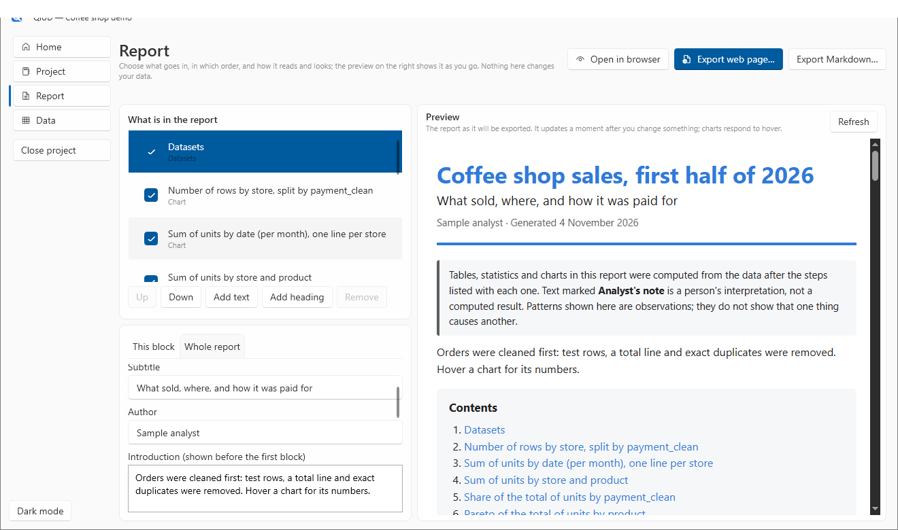
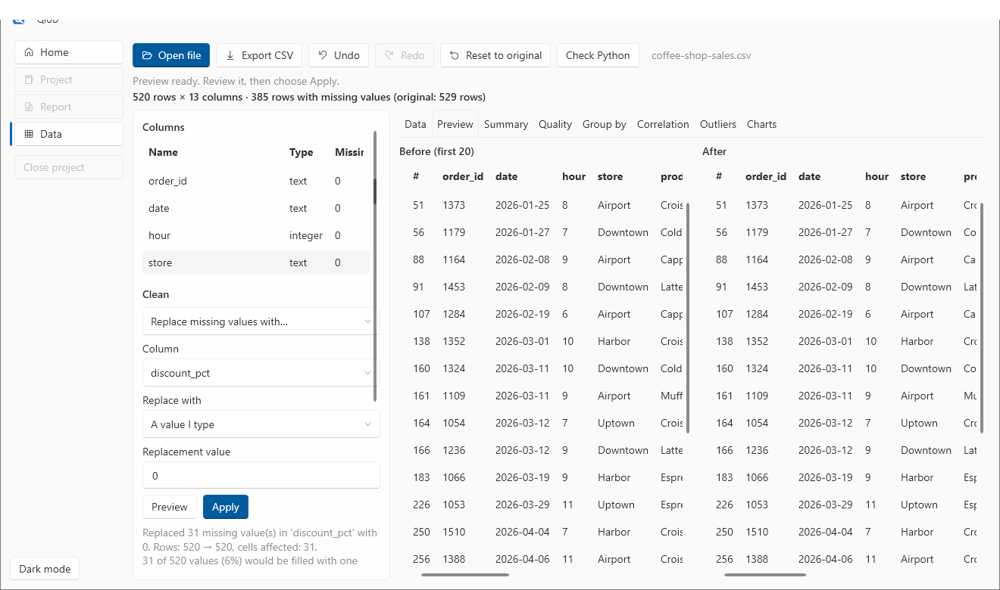
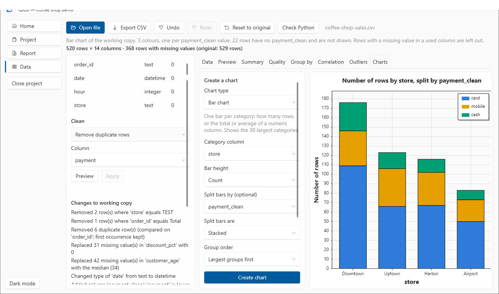
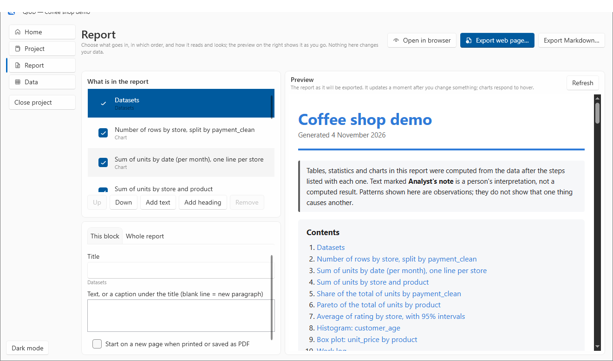
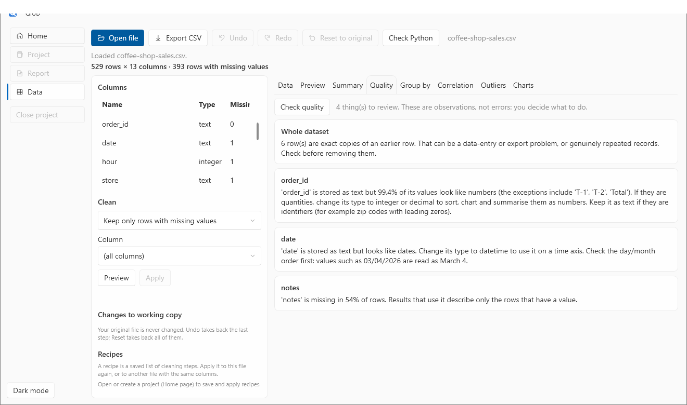
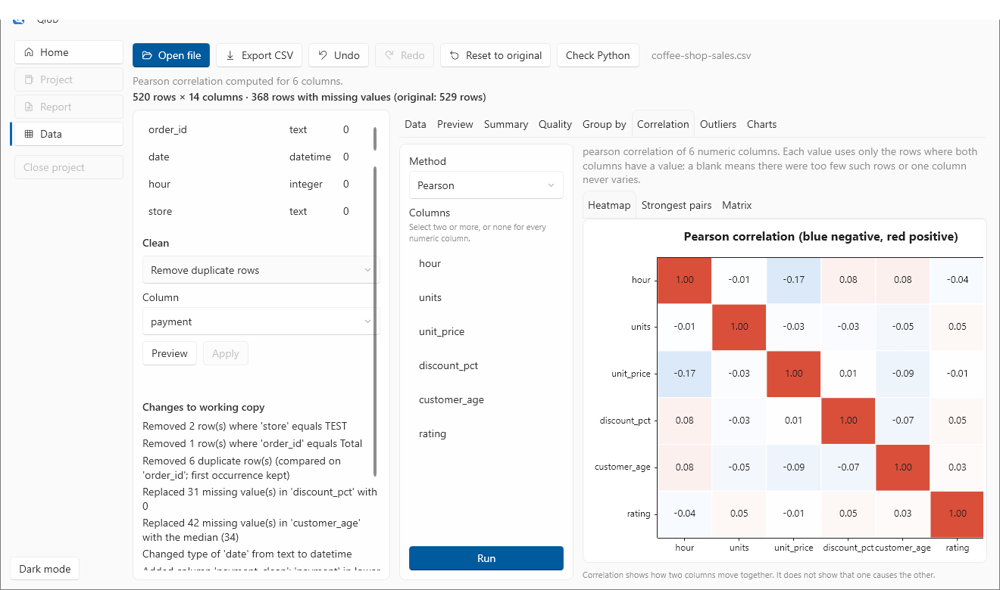
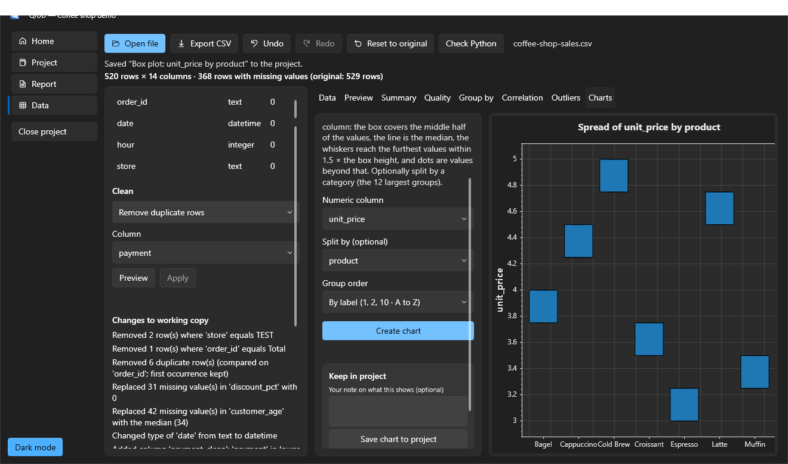

# QiUD

**A free data-analysis workbench for Windows.** Open a spreadsheet, clean it with a preview before every change, explore it, chart it, and turn the result into an interactive report, all on your own computer, without writing code.

[**Download for Windows**](https://github.com/stanfelixskz/QiUD/releases/latest) · [Install guide](docs/install.md) · [Tutorials](#learn-it-in-an-afternoon) · [FAQ](docs/faq.md)

## What it is for

You have a CSV, Excel or JSON file. It has missing values, duplicates, a stray "Total" line, text where numbers should be. You want to understand it and show someone else, without learning a programming language and without uploading your data anywhere.

QiUD is built around one idea: **you stay in control.** It shows what a step will do *before* it does it, it never changes your original file, every step can be undone, and it describes what it finds without telling you what it means.

**Import → inspect → clean → explore → chart → report**

## What you can do

| | |
|---|---|
| **Open** | CSV, TSV, Excel (`.xlsx`, `.xlsm`, with a sheet picker that finds the header row) and JSON / JSON Lines (nested fields become columns). |
| **Inspect** | Sort, filter and search all rows; per-column types and missing counts; a summary of every column; a data-quality check that flags duplicates, numbers or dates stored as text, and mostly-empty columns. |
| **Clean, with a preview first** | Fill missing values (a value, the mean, the median or the most common value), remove duplicates or rows that match conditions, rename, move and retype columns, and add new columns (date parts, arithmetic, text operations, number ranges, joined columns). Undo, redo, or reset to the original at any time. |
| **Save the result** | Export the cleaned data as **CSV, Excel (`.xlsx`), JSON or JSON Lines**. Your original file is never overwritten. |
| **Reuse your work** | Save the cleaning steps as a **recipe** and replay it on next month's file. |
| **Explore** | Group-by summaries, correlations, and outlier inspection. |
| **Chart** | Bar (stacked or side by side), line, summary line, area, scatter (coloured and sized by other columns), histogram, box plot, pie, donut, Pareto, averages with error bars and heatmaps. |
| **Keep it together** | Projects remember your datasets, saved charts and analyses, notes, and the steps you applied. |
| **Report** | Build a report with a **live preview**: choose and order the blocks, write your own text, and change titles, colours, fonts and chart styles. Export **one self-contained HTML file** that opens offline in any browser, with hover tooltips and print styles for PDF. |

## See it

| Clean with a preview | Charts | Reports |
|---|---|---|
|  |  |  |

| Quality checks | Group-by and correlation | Dark mode |
|---|---|---|
|  |  |  |

An example of a finished report (made from the sample data in this repository) is in [`examples/`](examples): [open the HTML report](examples/coffee-shop-report.html) after downloading it, or look at the [PDF](examples/coffee-shop-report.pdf).

## Install

1. Download **`QiUD-0.4.0-Setup.exe`** from the [latest release](https://github.com/stanfelixskz/QiUD/releases/latest).
2. Run it and accept the licence. It installs for you only (no administrator rights).
3. Windows may show a "Windows protected your PC" notice because the program is not code-signed yet. Choose **More info → Run anyway**. You can [check the file's SHA-256](docs/verify-download.md) first.

Full details: [Install guide](docs/install.md).

**Needs:** Windows 10 or 11 (64-bit) and about 300 MB of disk space. Nothing else has to be installed first: QiUD carries its own runtime and its own copy of Python. The live report preview uses Microsoft Edge WebView2, which Windows 11 and most up-to-date Windows 10 computers already have (the app says so if it is missing, and everything else still works).

## Learn it in an afternoon

The tutorials use the [sample data](sample-data) in this repository: an invented coffee shop's orders, with realistic problems built in on purpose.

| # | Tutorial | You will learn |
|---|---|---|
| 1 | [Open and inspect a file](docs/tutorials/01-open-and-inspect.md) | Loading, sorting, filtering, the summary and the quality check |
| 2 | [Clean your data](docs/tutorials/02-clean-your-data.md) | Previews, removing rows, duplicates, missing values, types, new columns, undo |
| 3 | [Explore: group-by, correlation, outliers](docs/tutorials/03-explore.md) | Summarising and spotting unusual values |
| 4 | [Make charts](docs/tutorials/04-charts.md) | Every chart type and when to use it |
| 5 | [Projects and recipes](docs/tutorials/05-projects-and-recipes.md) | Keeping your work together and replaying steps |
| 6 | [Build a report](docs/tutorials/06-build-a-report.md) | The report page, live preview, customising and exporting |
| 7 | [Excel and JSON files](docs/tutorials/07-excel-and-json.md) | Sheet picker, header rows, nested fields |

More: [Reference](docs/reference.md) · [FAQ and troubleshooting](docs/faq.md) · [Known limits](docs/reference.md#known-limits) · [Privacy](docs/privacy.md) · [Changelog](CHANGELOG.md)

## Your data stays yours

- QiUD works entirely on your computer. It contains no code that connects to the internet, and it sends nothing anywhere. See [Privacy](docs/privacy.md).
- It **never changes your original file.** Cleaning happens on a working copy; you choose when to export.
- It describes what it finds ("3 values flagged") and never claims a pattern is meaningful or that data is correct. Deciding what an unusual value means is your job.

## Licence and source

QiUD is **free to use**, including for work. It is **not open source**: the source code is not published, and the licence does not allow selling, modifying or reverse engineering it. Read the full terms in [LICENSE.txt](LICENSE.txt). The installer shows the licence and asks you to accept it.

QiUD includes open-source software (.NET, ScottPlot, SkiaSharp, Apache ECharts, pandas, NumPy and others), each under its own licence. The list is in `THIRD-PARTY-NOTICES.txt` inside the installed program's folder.

## Feedback and help

- A bug or something confusing? [Open an issue](https://github.com/stanfelixskz/QiUD/issues/new/choose). **Do not attach files that contain private data;** describe the problem, or use the sample data to reproduce it.
- An idea? Open a feature request. The [Reference](docs/reference.md#known-limits) lists what is not there yet.
- A security problem? See [SECURITY.md](SECURITY.md).

This repository holds the documentation, sample data and releases of QiUD. It does not contain the program's source code.
