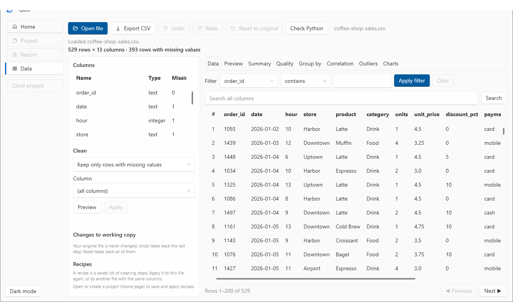
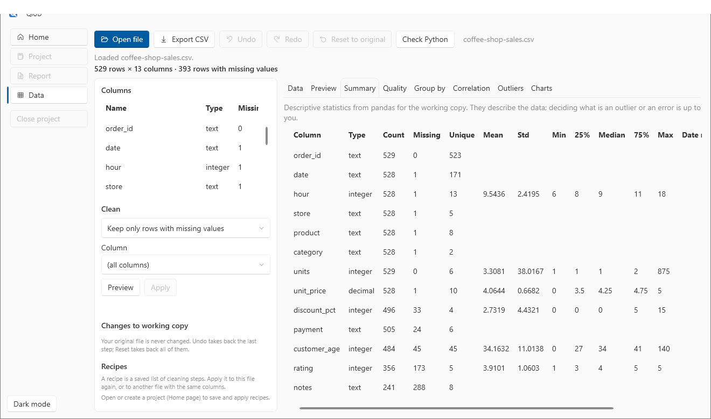
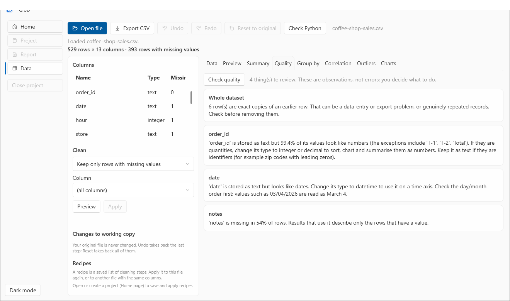

# 1. Open and inspect a file

**You will:** open a CSV file, look around it, and let QiUD point out what needs attention. About 10 minutes.

**You need:** QiUD [installed](../install.md) and the sample file [`coffee-shop-sales.csv`](../../sample-data/coffee-shop-sales.csv). It is an invented coffee shop's orders from January to June 2026, with realistic problems put in on purpose (see the [sample data notes](../../sample-data/README.md)). Download it from this repository, or use any CSV of your own.

## Open the file

Start QiUD. On the **Home** page choose **Explore a file without a project**, and pick the file. (You can also use **Open file** on the Data page, or pass the path on the command line: `QiUD.exe coffee-shop-sales.csv`.)

QiUD reads the file and switches to the **Data** page:

What you are looking at:

- **Top line:** `529 rows × 13 columns · 393 rows with missing values`. The count of rows with at least one empty cell tells you early how much cleaning there is.
- **Columns** (left): each column's name, its **detected type** (text, integer, decimal, true/false, date/time) and how many values are **missing**. Types matter: you can only average a number, and a chart over time needs a date.
- **The table** (right): the rows, 200 at a time. Use **Previous / Next** under it.
- **Tabs:** Data, Preview, Summary, Quality, Group by, Correlation, Outliers and Charts. You will use all of them in these tutorials.

QiUD detects the field separator (comma, semicolon, tab or pipe), handles quoted fields and a byte-order mark, and falls back to the older Windows-1252 encoding with a note if the file is not UTF-8.

> **Your original file is never changed.** Everything you do happens to a *working copy* in memory. Closing QiUD or choosing **Reset to original** puts you back to the file as it was.

## Sort, filter and search

- **Sort:** click a column header. It sorts *all* rows, not just the 200 you can see, and numbers sort as numbers (1, 2, 10, not 1, 10, 2). Click again for the reverse.
- **Filter one column:** pick a column, a condition (*contains, equals, does not equal, greater than, less than, is empty, is not empty*), type a value and choose **Apply filter**. A "Filter active" badge and a line such as `Rows 1–14 of 14 (filtered from 529)` show the state. **Clear** brings every row back.
- **Search all columns:** type in the search box and press Enter. What you type is matched literally, so brackets, quotes and `%` are ordinary characters.

Try it: filter `store` *equals* `TEST`. Two rows appear, both with the product "TEST ITEM". These are test entries from a till, and they should not be in your analysis. (You will remove them in the [next tutorial](02-clean-your-data.md).) Choose **Clear**.

## The Summary tab

Open **Summary**. For every column you get the count, missing, unique values, and, for numbers, the mean, standard deviation, minimum, quartiles, median and maximum; for dates the date range; otherwise the most common value.

Two things stand out:

- `customer_age` has a **minimum of 0** and a **maximum of 140**. Nobody is 0 or 140 years old. These look like typing mistakes.
- `units` has a **maximum far above everything else** (hundreds, when most orders are 1 to 4). The `Total` line that a spreadsheet export added at the bottom is being counted as an order.

QiUD does not decide these are errors: it shows the numbers and leaves the judgement to you.

## The Quality tab

Open **Quality**. QiUD checks for the common problems and explains each one:

- **Whole dataset:** `6 row(s) are exact copies of an earlier row.` Check before removing them: sometimes repeated rows are real.
- **order_id** is stored as text *"but 99.4% of its values look like numbers (the exceptions include 'T-1', 'T-2', 'Total')"*. That tells you where the test rows and the footer are hiding.
- **date** is stored as text but looks like dates, so it cannot be used on a time axis yet. QiUD warns that a value like `03/04/2026` is read as **month/day/year** (March 4); check your data's convention.
- **notes** is missing in about half of the rows, so anything using it describes only the rows that have a value.

These are *observations, not errors*: there is no automatic fix, and a clean report only means these particular checks found nothing. Quality runs by itself for files up to 250,000 rows; for bigger files choose **Check quality**.

## What you have now

A list of things to deal with: two test rows, a `Total` footer, six duplicates, missing values, impossible ages, dates stored as text. Continue with [**2. Clean your data**](02-clean-your-data.md).
