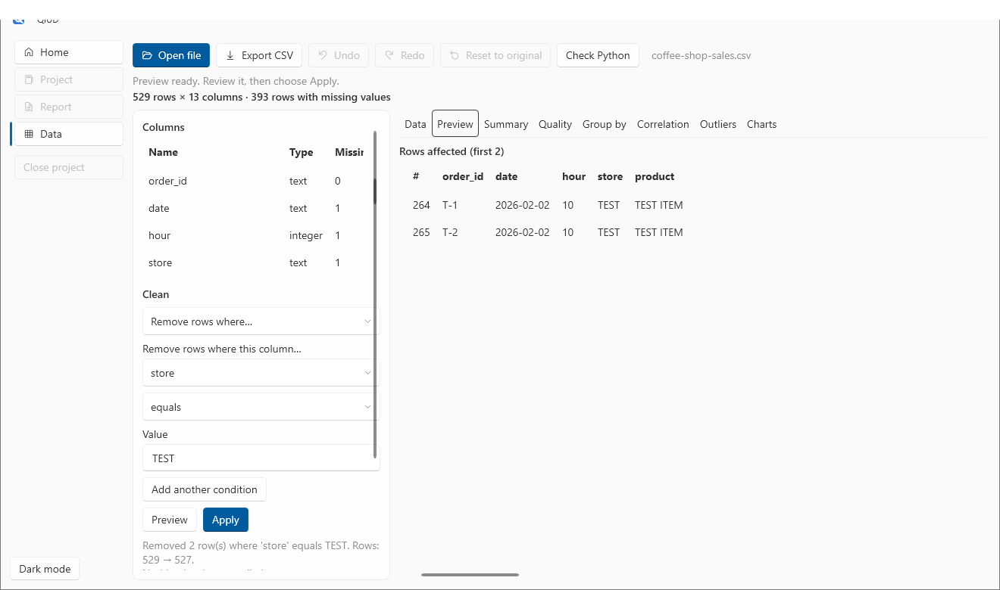
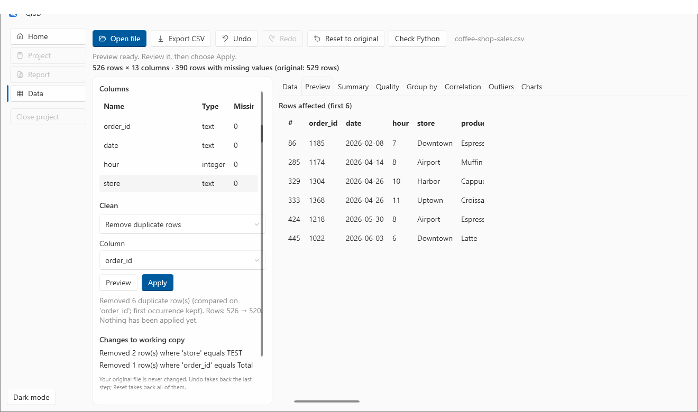
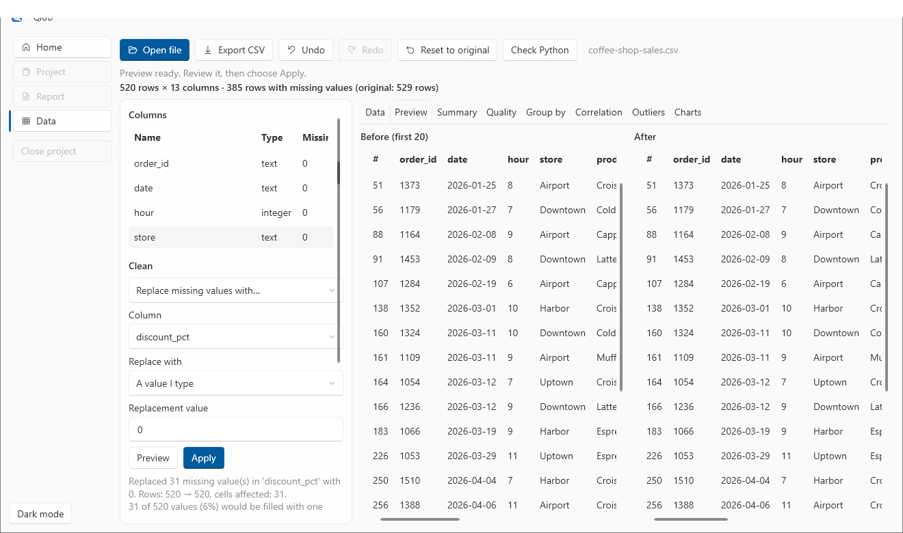
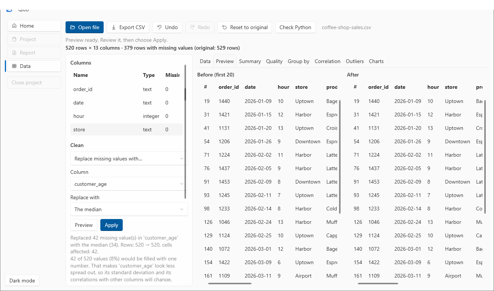
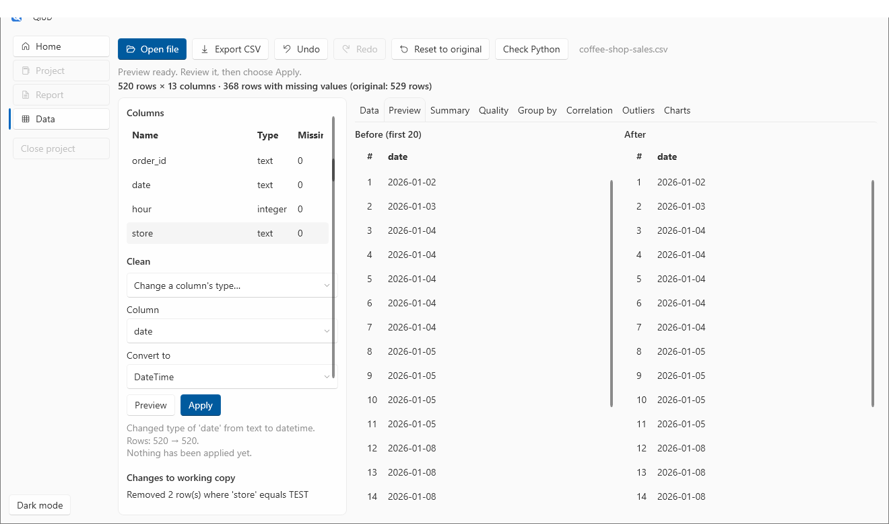
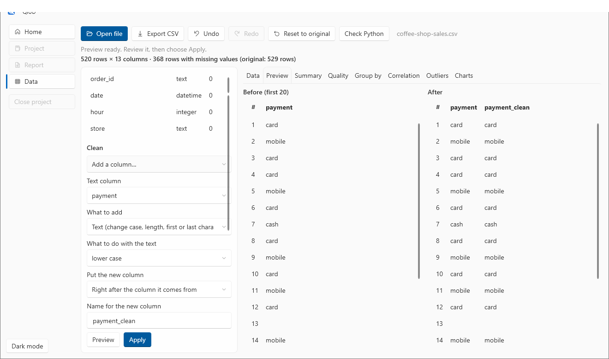
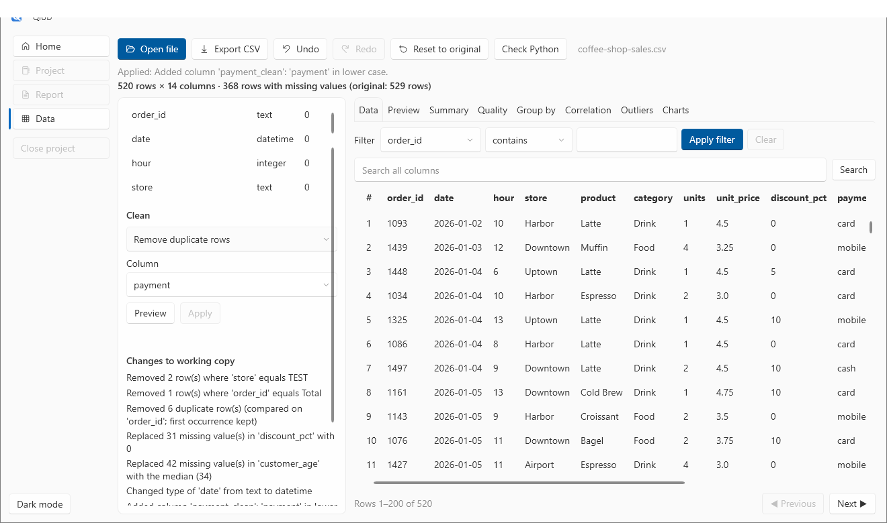

# 2. Clean your data

**You will:** fix every problem found in [tutorial 1](01-open-and-inspect.md), one step at a time, always looking at a preview first. About 25 minutes.

**You need:** `coffee-shop-sales.csv` open on the Data page.

## How cleaning works

All cleaning is in the **Clean** panel on the left of the Data page:

1. Choose what to do from the list, and fill in its settings.
2. Choose **Preview**. QiUD shows what *would* change, in the **Preview** tab, with the rows before and after, and writes a sentence under the panel such as `Rows: 529 → 527`. **Nothing has changed yet.**
3. If you like it, choose **Apply**. (**Apply** stays disabled until you have previewed the current settings, so you always look first.)

Every applied step is listed under **Changes to working copy**. **Undo** (or `Ctrl+Z`) takes back the last step, **Redo** (`Ctrl+Y`) puts it back, and **Reset to original** takes back all of them. Your file on disk is never touched.

## Step 1: remove the test rows

Choose **Remove rows where…**, then:

- the column: `store`
- the condition: `equals`
- the value: `TEST`

Choose **Preview**.

The preview lists the **rows affected**: two rows, `T-1` and `T-2`, both from store `TEST`. That is exactly what you wanted. Choose **Apply**. The status line says `Removed 2 row(s) where 'store' equals TEST`.

The same condition list is used by the filter on the Data tab, so *"rows where store equals TEST"* removes exactly the rows the filter would have shown. You can combine up to 10 conditions with **Add another condition** and choose whether a row must match *all* of them or *any one* of them.

## Step 2: remove the Total line

Still on **Remove rows where…**: change the column to `order_id`, keep `equals`, and type the value `Total`. **Preview** shows one row, **Apply**.

> Spreadsheet exports often end with a total line. Left in, it is counted as a very large order and ruins every average and chart. The Quality tab told you it was there ("the exceptions include … 'Total'").

## Step 3: remove duplicate rows

Choose **Remove duplicate rows**.

- Leave the column on **(all columns)** to treat a row as a duplicate only when *every* value matches.
- Or choose one column, such as `order_id`, to treat rows with the same order number as the same order.

The **first occurrence is kept**. Choose **Preview**:

The preview shows the rows that would be removed. Check them, then **Apply**. Six rows go.

## Step 4: fill the missing discounts

`discount_pct` is empty for some orders where nobody recorded a discount. In this shop an empty discount means no discount, so zero is the right value.

Choose **Replace missing values with…**, column `discount_pct`, **A value I type**, and type `0`.

The preview shows rows **before and after** and says `Replaced 31 missing value(s) in 'discount_pct' with 0`. Apply it.

You have four ways to fill a gap:

| Choice | What it does |
|---|---|
| **A value I type** | Your value. It is refused if it does not fit the column's type (text in a number column). |
| **The mean (average)** | The average of the values the column already has. |
| **The median** | The middle value. Less affected by extreme values than the mean. |
| **The most common value** | The value that appears most often (a tie goes to the smallest value, so the result is repeatable). |

The mean and median only work on number columns. In a whole-number column the result is rounded, and the preview says so.

## Step 5: fill the missing ages with the median

`customer_age` is missing for some customers. Choose **Replace missing values with…**, column `customer_age`, **The median**.

The preview shows the exact number it will use (`the median (34)`) and warns you about the cost: filling many cells with one value makes the column look less spread out, which changes its standard deviation and its correlations with other columns. **That is a trade-off for you to weigh, not a decision QiUD makes.** Here we accept it. Apply.

> Missing is not the same as zero or "average". Sometimes the honest answer is to leave a gap and let results describe only the rows that have a value. QiUD warns when a fill changes a large share of a column.

## Step 6: turn the dates into real dates

The `date` column is text, so it cannot be used on a time axis. Choose **Change a column's type…**, column `date`, convert to **DateTime**.

The preview shows before and after, how many values *cannot* convert (they would become missing, with examples), and warns if leading zeros such as `007` would be lost. Here every date converts. Apply, and `date` now shows as `datetime` in the Columns list.

## Step 7: add a cleaned payment column

Look at the payment values in the data: `card`, `Card`, `CARD`, `mobile`, `Mobile`, `cash`. To a person these are the same, but to a chart they are separate groups. Fix it with a new column.

Choose **Add a column…**:

- the column to start from: `payment`
- what to add: **Text (change case, length, first or last characters, split, replace)**
- what to do with the text: **lower case**
- name for the new column: `payment_clean`

The preview shows `payment` beside `payment_clean`. Apply. The new column is placed right after the one it comes from (you can choose "at the end of the table" instead).

You can add several kinds of column: **a part of a date** (hour, weekday, month name, week, quarter and more), **arithmetic** (one column plus, minus, times or divided by another column or a number), **time between two dates**, **text operations** (change case, trim spaces, length, first or last characters, before or after a separator, replace, contains, patterns), **group a number into ranges** (such as age bands, with equal widths, equal counts, or your own boundaries) and **join columns** into one. Each is previewed, recorded and undoable like any other step.

## The finished table

Look at **Changes to working copy**. It now reads, in order:

1. Removed 2 row(s) where 'store' equals TEST
2. Removed 1 row(s) where 'order_id' equals Total
3. Removed 6 duplicate row(s)
4. Replaced 31 missing value(s) in 'discount_pct' with 0
5. Replaced 42 missing value(s) in 'customer_age' with the median (34)
6. Changed type of 'date' from text to datetime
7. Added column 'payment_clean'

That list is a complete, readable record of what was done to the data. In [tutorial 5](05-projects-and-recipes.md) you will save it as a **recipe** so the same cleaning can be replayed on next month's file with one click.

## Other things the Clean list can do

- **Keep only rows with missing values** / **Remove rows with missing values** (in all columns or one): to look at, or drop, the incomplete rows.
- **Rename a column…**
- **Move a column…** to the start or end, or before or after another column. You can also **drag a column header** in the table to move it. A drag is an ordinary, undoable step.

## Still unusual: the ages

The impossible ages (0 and 140) are still there. QiUD never removes a value just because it is odd. Find them in [tutorial 3](03-explore.md), then decide what to do.

## Export the cleaned data

**Export CSV** (top of the Data page) writes the *working copy* as a new CSV file. QiUD asks where to save it, and it never overwrites your original.

**Next:** [3. Explore: group-by, correlation and outliers](03-explore.md)
