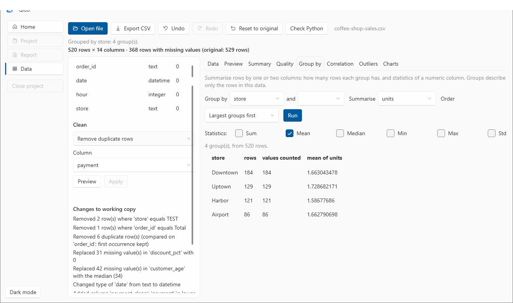
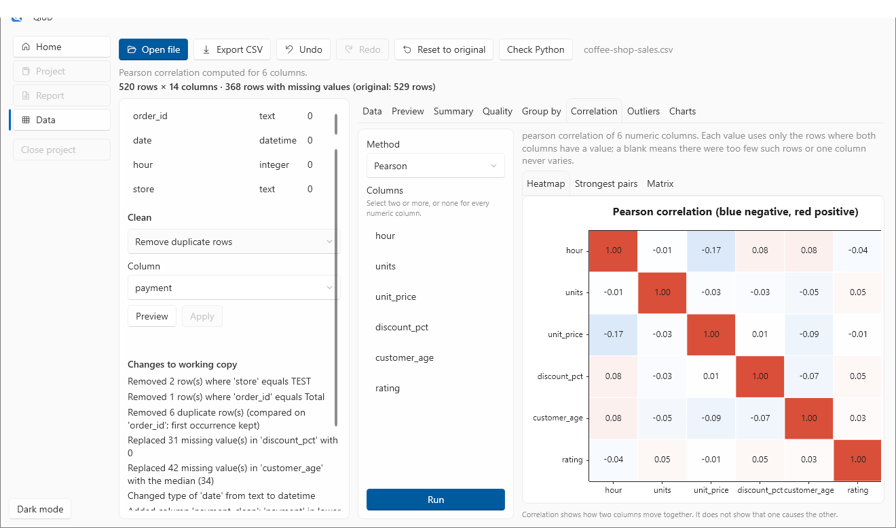
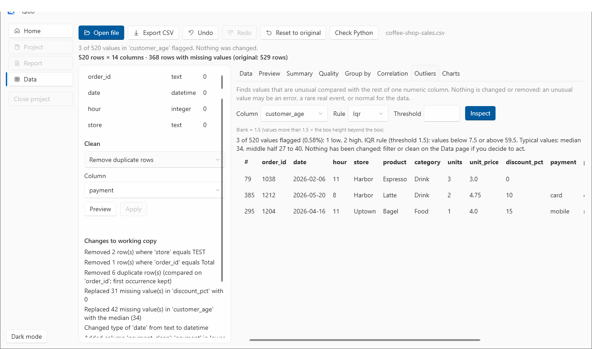

# 3. Explore: group-by, correlation and outliers

**You will:** summarise the data by group, see how numeric columns move together, and find values that do not fit the rest. About 15 minutes.

**You need:** the cleaned `coffee-shop-sales.csv` from [tutorial 2](02-clean-your-data.md).

These three tabs **describe the data as it is now**. Their results are cleared when you clean, reset or open another file, so an old result is never mistaken for one about new data.

## Group by: summarise rows by category

Open the **Group by** tab. It answers questions like *how many orders did each store have, and what was the typical number of units?*

1. **Group by:** `store`. (You can add a second column after **and**, for example `category`.)
2. **Summarise:** `units`. This is optional; leave it as *(count rows only)* to just count rows per group.
3. Tick the **statistics** you want: Sum, Mean, Median, Min, Max, Std dev.
4. Choose how to order the groups (largest first, or by label) and choose **Run**.

You get one row per group: its number of rows, how many values were counted (rows with a missing value are not counted, and the table says so), and each statistic you picked. It also says how many rows could not be grouped because the group value was missing.

Group-by uses at most two grouping columns and shows up to 500 groups.

## Correlation: which columns move together?

Open **Correlation**.

- **Method:** *Pearson* (straight-line relationships) or *Spearman* (do bigger values tend to go with bigger values, even if not in a straight line).
- **Columns:** select two or more, or select none to use every numeric column (up to 40).
- Choose **Run**.

The **Heatmap** colours each pair: blue for negative, red for positive, white for none. The **Strongest pairs** tab lists the strongest first, with how many rows each coefficient is based on and a flag when that is few. The **Matrix** tab gives the numbers.

In this sample almost nothing is strongly correlated (the data is invented with independent columns), and that is the right thing for the tool to show you.

> **A correlation shows that two columns move together. It does not show that one causes the other.** QiUD prints this under every result as a reminder. A pair with few rows or a column with no variation shows as blank rather than as a misleading number.

## Outliers: unusual values

Open **Outliers**. This is where the impossible ages from tutorial 1 show up.

1. **Column:** `customer_age`.
2. **Rule:** *IQR* (flags values far outside the middle half of the data) or *Z-score* (flags values many standard deviations from the mean). Leave the **threshold** blank to use the usual default (1.5 for IQR).
3. Choose **Inspect**.

QiUD reports how many values were flagged, how many are low and how many high, the rule it applied (`values below 7.5 or above 59.5` here), and what typical values look like (`median 34, middle half 27 to 40`). The flagged rows are listed in full so you can look at the whole order.

**Nothing has been changed or removed.** An unusual value may be an error, a rare but real event, or perfectly normal for the data. Here two of the flagged values were typed on purpose as mistakes (an age of 0 and an age of 140). If you decide they are errors, go back to the Data page:

- **Remove rows where…** `customer_age` `greater than` `100` removes the 140 row.
- **Remove rows where…** `customer_age` `less than` `10` removes the 0 row.

Or you could keep them and note the question in a report. The decision, and the reason for it, are yours.

## Saving what you find

If you have a **project** open (see [tutorial 5](05-projects-and-recipes.md)), each of these tabs has **Save to project** and a box for **your note on this result**. Computed numbers and your interpretation are kept apart, so a reader can tell which is which. The saved result remembers which cleaning steps had been applied when it was made.

**Next:** [4. Make charts](04-charts.md)
