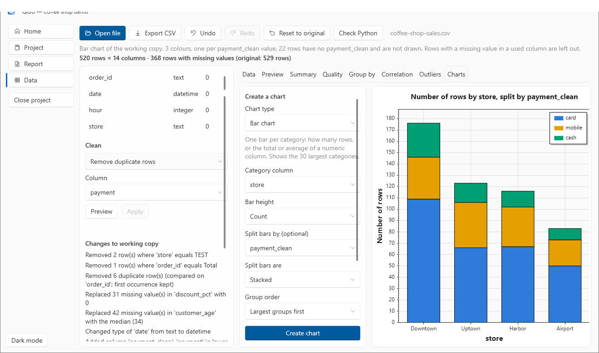
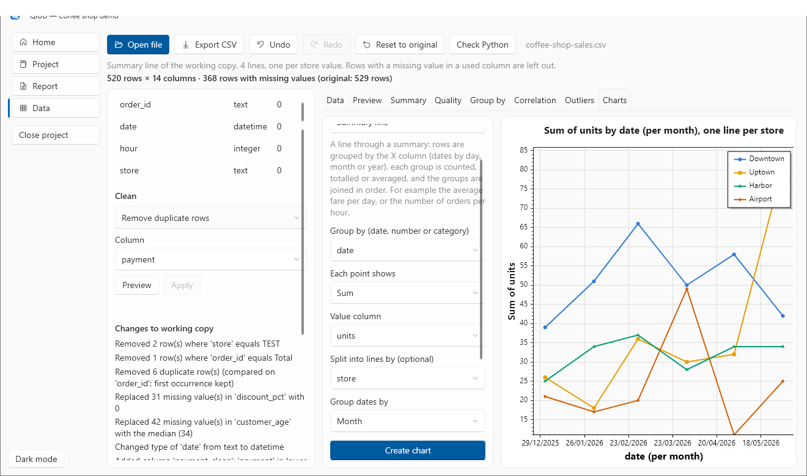
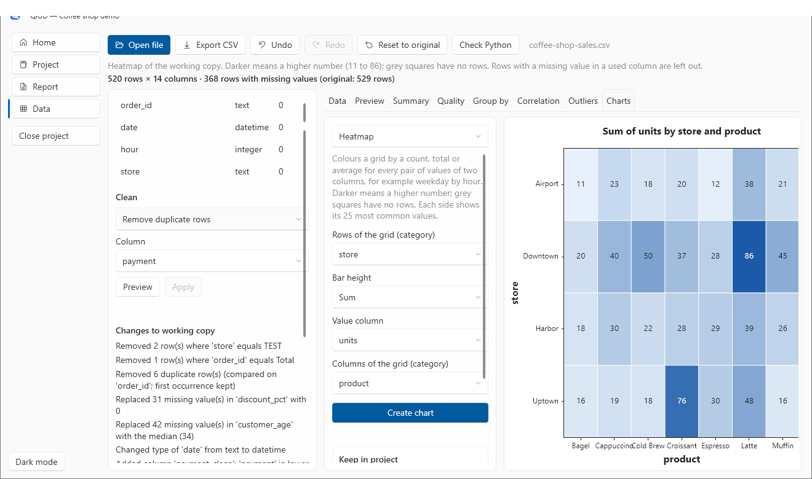
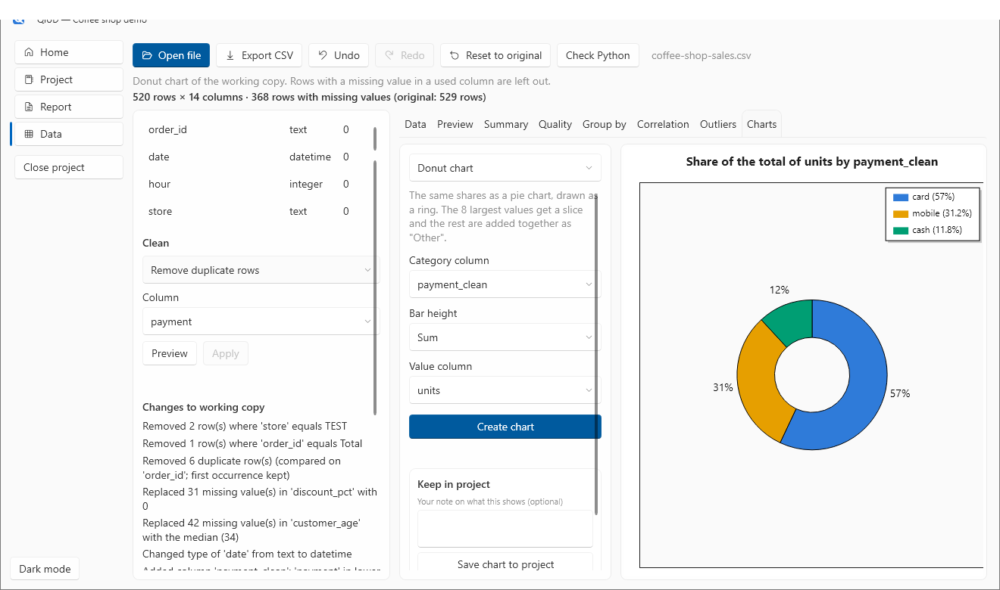
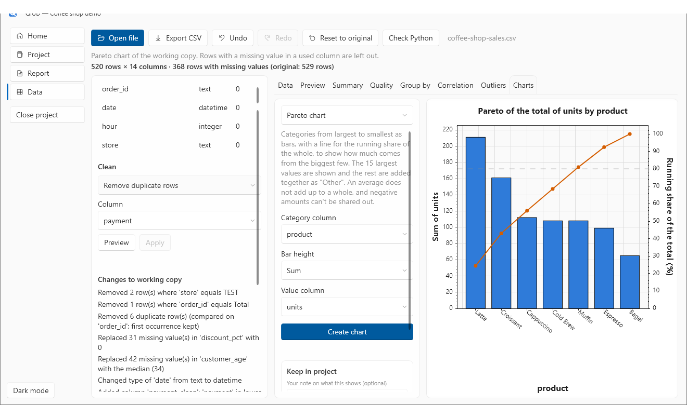
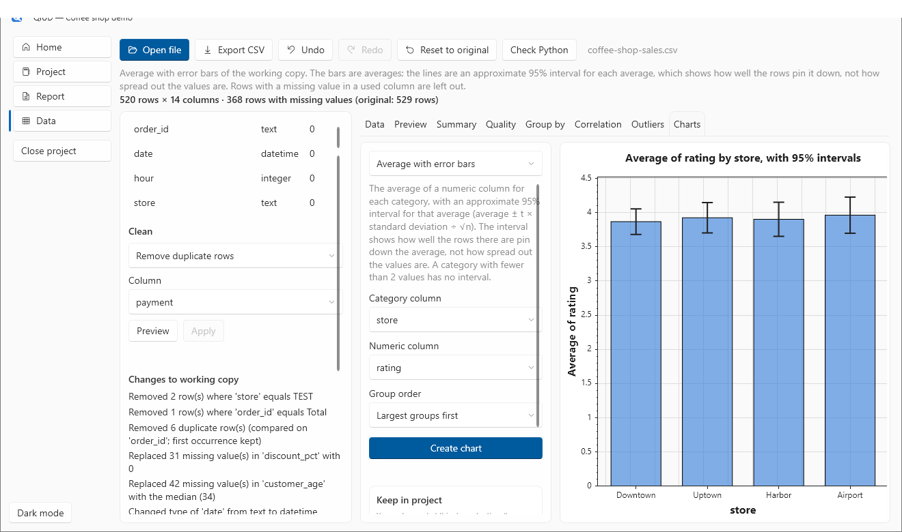
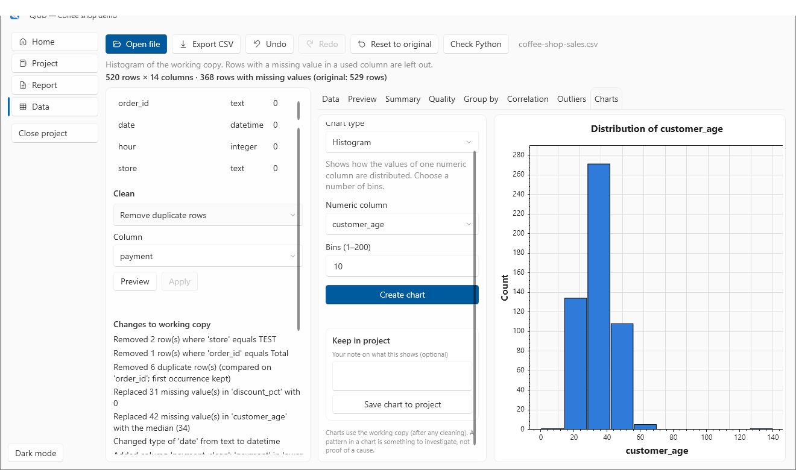
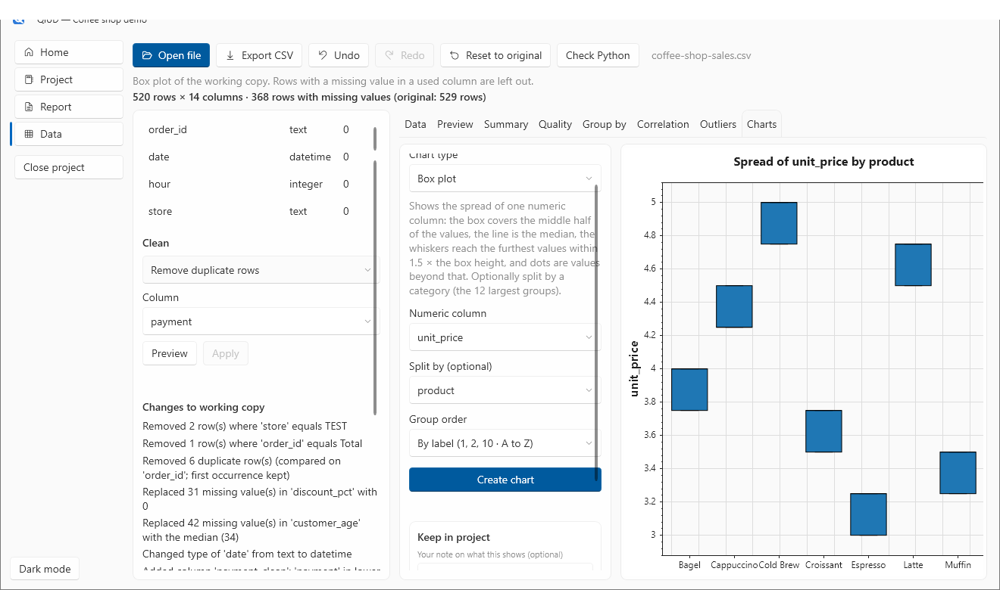
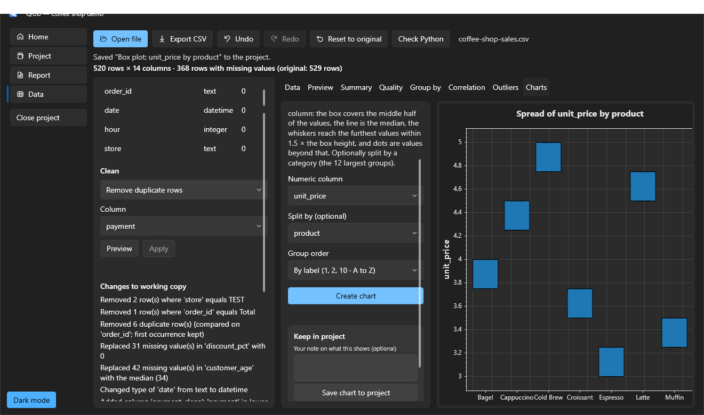

# 4. Make charts

**You will:** make a chart of every kind QiUD has, and learn which one answers which question. About 25 minutes.

**You need:** the cleaned `coffee-shop-sales.csv` from [tutorial 2](02-clean-your-data.md), including the `payment_clean` column.

## The basics

Open the **Charts** tab. On the left, **Create a chart**:

1. Pick a **chart type**. A short description appears under it.
2. Pick the columns. The pickers offer only suitable columns (a chart that needs numbers will not offer text columns), and their labels change with the chart type.
3. Choose **Create chart**. The status line says what is drawn and how many rows were left out because a value they needed was missing.

Charts always use the **working copy**: if you clean the data, charts change with it. A pattern in a chart is **something to investigate, not proof of a cause**.

Below the picker is **Keep in project**. With a [project open](05-projects-and-recipes.md), add an optional note about what the chart shows and choose **Save chart to project**. The chart is saved as a picture *and* with its numbers, so the [report](06-build-a-report.md) can draw it again in your own colours.

## Which chart for which question

| Chart | Answers | Good to know |
|---|---|---|
| **Bar chart** | How many rows, or what total or average, in each category? | Shows the 30 largest categories. Can be split into colours (stacked or side by side). |
| **Line chart** | How does a number change along another number or a date? | Sorted by the X values. Very long lines are thinned to 5,000 evenly spaced points. |
| **Summary line** | What is the count, total or average per day, month, year or category, joined in order? | Dates can be grouped by day, month or year. Can be split into up to 8 lines. |
| **Area chart** | The same, filled down to zero, to show *how much* there is. | Split areas overlap rather than stack. |
| **Scatter plot** | Do two numbers go together? | Can be coloured by a category and sized by another number. |
| **Histogram** | How are the values of one number spread out? | You choose the number of bins (1 to 200). |
| **Most common values** | Which values appear most often in a column? | Shows the 20 most common. |
| **Box plot** | How spread out is a number, and where are the unusual values? | Can be split by a category (the 12 largest groups). |
| **Pie chart / Donut chart** | How does a whole divide up? | Counts or totals only; the 8 largest values get a slice and the rest are added together as "Other". |
| **Heatmap** | What is the count, total or average for every *pair* of values of two columns? | Each side shows its 25 most common values. |
| **Pareto chart** | How much of the total comes from the biggest few? | Bars largest first plus a running-share line. |
| **Average with error bars** | What is the average per category, and how well pinned down is it? | The lines are an approximate 95% interval. |

## Walk through them

### A bar chart split into colours

**Bar chart** · Category column `store` · Bar height **Count** · Split bars by `payment_clean` · Split bars are **Stacked**.

Each bar is a store. The colours show how its orders were paid for. Switch **Split bars are** to **Side by side** to compare the payment methods directly.

- **Averages are never stacked**, because averages do not add up. QiUD places them side by side and says so.
- Rows with no value in the split column are not drawn and are counted in the status line.
- Up to 8 values get a colour (the ones with the most rows).

### A summary line over time

**Summary line** · Group by `date` · Each point shows **Sum** of `units` · Split into lines by `store` · Group dates by **Month**.

Rows are grouped by month, units are totalled in each group, and the groups are joined in time order. Each store gets its own line. A line skips a group it has no rows for, rather than drawing a zero (the status line says so).

### A heatmap of two categories

**Heatmap** · Rows `store` · **Sum** of `units` · Columns `product`.

Darker means a higher total, and the numbers are printed in the squares. A grey square means *no rows*, which is not the same as a measured zero.

### A donut

**Donut chart** · Category `payment_clean` · **Sum** of `units`.

The legend gives each exact percentage. A pie refuses an *average* (an average does not add up to a whole) and negative totals, and tells you why.

### A Pareto chart

**Pareto chart** · Category `product` · **Sum** of `units`.

Products from largest to smallest, and a line for the running share of all units. The dashed line marks 80%. It shows how much of the total the biggest few account for.

### Averages with error bars

**Average with error bars** · Category `store` · Numeric column `rating`.

The bars are averages. The lines are an approximate **95% interval** for each average: they show how well the ratings that exist pin the average down, **not** how spread out the individual ratings are. A category with fewer than 2 values has no interval, and the status line says so. (In this sample only some orders have a rating, and the averages are all close to 4.)

### A histogram

**Histogram** · Numeric column `customer_age` · Bins `10`.

The tall bars are the ordinary customers. The tiny far-right bar is the 140-year-old typing mistake: charts are a good way to *see* an outlier.

### A box plot

**Box plot** · Numeric column `unit_price` · Split by `product`.

The box covers the middle half of the values, the line is the median, the whiskers reach the furthest values within 1.5 × the box height, and dots are values beyond that. In this sample each product has just two prices (before and after a price rise in April), so the boxes are narrow.

### Also try

- **Scatter plot** with `Colour points by` a category and `Size points by` a number (a bubble chart in one).
- **Line chart** of one number along another.
- **Most common values** for any column, for a quick look at what is in it.

## Dark mode

The **Dark mode** switch at the bottom left changes the whole app, and the charts follow it.

**Next:** [5. Projects and recipes](05-projects-and-recipes.md)
