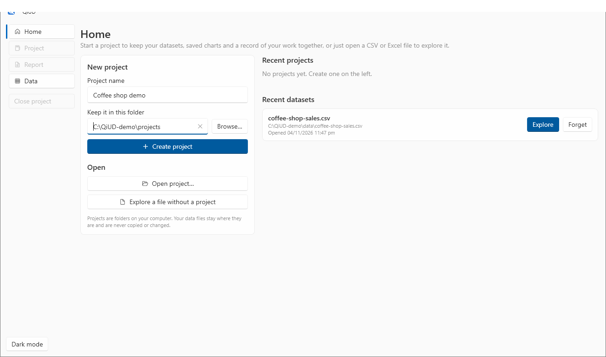
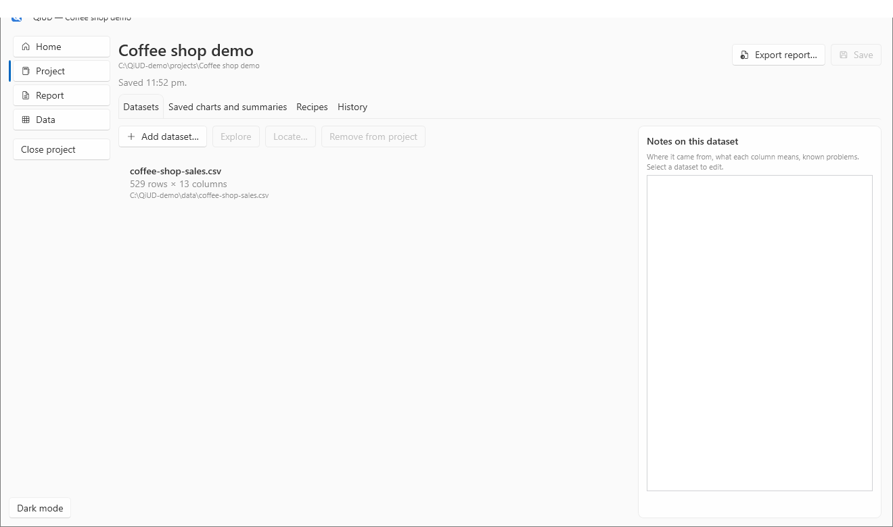
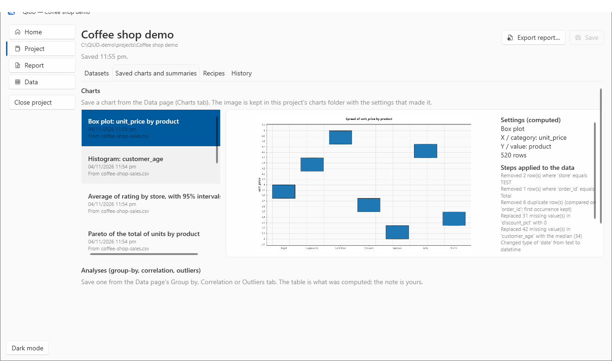

# 5. Projects and recipes

**You will:** keep your work together in a project, and save your cleaning steps as a recipe you can replay. About 15 minutes.

## Why a project

You can explore a single file without any setup (**Explore a file without a project** on the Home page). A **project** is for work you want to come back to. It is a folder you choose, and it keeps:

- the **datasets** you used (by file location: your data files are never copied, moved or changed),
- the **charts and analyses** you saved, each with your own note,
- your **recipes**,
- a **history** of what you did,
- the layout of your **report**.

A project is a normal folder with a `project.json` file and a `charts` folder, so you can back it up, zip it or move it like any other.

## Create a project

On the **Home** page, under **New project**, type a name and choose the folder to keep it in (use **Browse…**), then choose **Create project**.

The Home page also lists your **recent projects** and **recent datasets**, each with **Open** or **Explore**, and **Forget** to remove an entry from the list (it never deletes a file). A dataset or project that has been moved or deleted is marked "not found".

If you already have a file open on the Data page when you create the project, it is added to the project for you. A file left over from a project you have since closed is *not* carried into a new one.

## The Project page

Four tabs:

- **Datasets:** the files in this project, with how many rows and columns each had, whether the file on disk has changed since, and a notes box for where it came from and any known problems. **Add dataset…**, **Locate…** (if you moved a file), **Remove from project** (the file itself is untouched).
- **Saved charts and summaries:** everything you saved with **Save chart to project** or **Save to project**.
- **Recipes:** your saved cleaning recipes.
- **History:** a timeline of what happened in the project.

Select a saved chart to see the picture, the settings that made it (`X / category`, `Y / value`, and so on) and **the steps that had been applied to the data** when it was made. That is what lets a reader tell exactly what the chart is built on.

QiUD saves the project when you leave the page, close the project, or exit.

## Restoring your steps

Applied cleaning steps are remembered per dataset. When you reopen a dataset in a project, QiUD asks whether to **restore the steps you had applied**, and shows what they were. Only applied steps are remembered, not the redo history.

## Recipes: replay your cleaning

A **recipe** is a saved, named list of cleaning steps. It is the answer to *"next month's export arrives with the same problems."*

**Save one.** After cleaning (tutorial 2), in the Clean panel on the Data page find **Recipes**, type a name such as `Clean coffee-shop export`, and choose **Save the steps above as a recipe**. (This needs an open project.)

**Apply one.** Open another file with the same columns. Under **Apply a saved recipe** choose the recipe, then **Preview recipe** (it shows what would happen) and **Apply recipe**.

How recipes behave:

- **All or nothing.** If a step cannot apply (for example a column it needs is missing), nothing changes, and the message names the step and the reason.
- They apply **by column name**, so a file with different columns fails cleanly rather than half-applying.
- A recipe applied to *different data* can give *different results* (a "remove rows where store equals TEST" step removes however many rows match this time). That is why the preview comes first.
- Recipes appear in the exported report with their steps in order.

**Share a recipe** with a colleague: in the Project page's **Recipes** tab choose **Export recipe…** to write a `*.recipe.json` file, and **Import recipe…** to read one. A recipe file is a short, readable list of steps and column names. It contains **none of your data**. Importing one checks it first and refuses anything that is not a valid recipe.

## Keeping your work safe

- Your **original data files are never modified.** The working copy lives in memory until you **Export data…**.
- **Undo and redo** apply within the current session of an open file. The undo stack itself is not saved, but the applied steps are (see above).
- Two copies of QiUD editing the same project at once is not supported: the last save wins.

**Next:** [6. Build a report](06-build-a-report.md)
