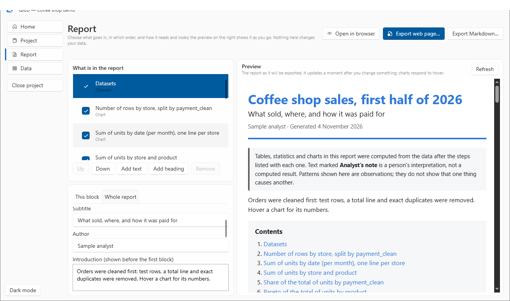
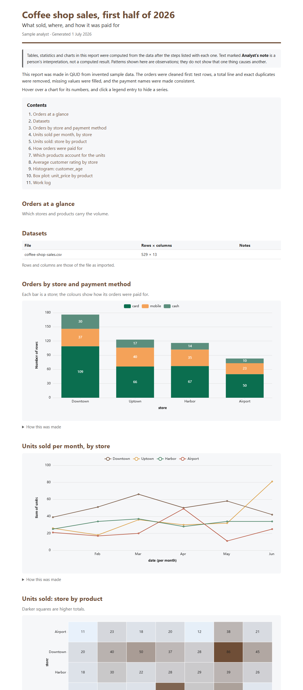
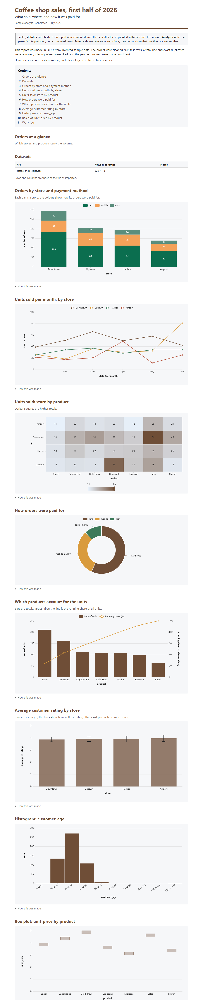
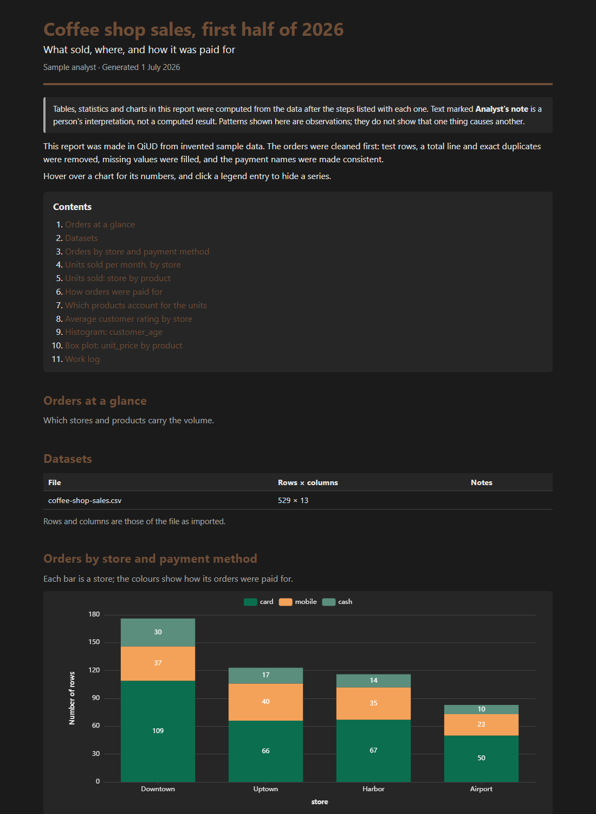

# 6. Build a report

**You will:** turn saved charts and analyses into a report you can share, with a live preview while you edit. About 20 minutes.

**You need:** a [project](05-projects-and-recipes.md) with a few charts saved to it (tutorial 4: use **Save chart to project** after creating each chart).

## The Report page

Choose **Report** in the side bar (it needs an open project). The page has two halves:

- **Left:** *What is in the report* (the blocks), and below it the settings of the selected block (**This block**) or of the whole report (**Whole report**).
- **Right:** a **live preview**: the report exactly as it will be exported, redrawn a moment after you change anything. It keeps your place in the page, and charts respond to hover.

Drag the dividers to give either side more room. You will not need to export and reopen the file to see a change.

## Blocks

Every chart, analysis and summary you saved is a **block**, along with a **Datasets** table, your **Recipes** and the **Work log**. New things you save later appear in the list by themselves; deleted ones disappear.

- **Tick** a block to include it. Unticked blocks are dimmed and left out.
- **Up / Down** change the order.
- **Add heading** and **Add text** insert your own headings and paragraphs, right after the selected block. **Remove** deletes the ones you added. (A saved chart or analysis is never deleted from here. Untick it instead.)

## Change a block ("This block")

Select a block, and under **This block**:

- **Title:** replaces the saved title. Leave it empty to use the saved one (shown as a hint under the box).
- **Text or caption:** a paragraph for a text block, or a caption under the title for anything else. A blank line starts a new paragraph.
- **Start on a new page** when printed or saved as PDF.
- **Show how it was made:** the dataset, row count and the cleaning steps applied before it was computed.
- **Show my note saved with it:** the note you wrote when you saved the chart or analysis, kept visibly apart as "Analyst's note".

### Change how a chart looks

For a chart saved with its numbers you can also set:

- **Bottom axis name** and **side axis name**.
- **Colours for this chart:** `#rrggbb` separated by commas, with swatches to show the result. Empty uses the report's colours.
- **Legend:** auto (shown when there is more than one series), show, or hide.
- **Height** in pixels (200 to 1000).
- **Show the numbers on the chart** and **Smooth the lines**.
- **Put this chart back to the default look**.

A chart saved by an older version of QiUD has only its picture. The report shows the picture and says its colours can't be changed. Create the chart again and save it to make it customisable.

## Change the whole report

Open the **Whole report** tab.

- **Title, subtitle, author:** the title defaults to the project's name.
- **Introduction** (before the first block) and **Closing text** (after the last).
- **Accent colour** (headings and links). A value that is not a colour is refused with an explanation (`“banana” is not a colour. Write it as #rrggbb`) and the old one is kept.
- **Chart colours:** five built-in colour sets, or choose *custom* and type your own list. The first built-in set is colour-blind-safe.
- **Font:** sans, serif or mono. **Background:** light, dark, or auto (follows the reader's system).
- **Show:** a contents list, the date and author line, the note on how to read the report, and the full folder of each dataset.

About that last switch: it is **off by default**, so a report you send to someone does not reveal where your files are stored on your computer. Likewise the note on how to read the report (what is *computed* and what is *your interpretation*) is **on by default**. You can switch it off.

## Output

At the top right of the page:

- **Open in browser:** writes a temporary copy and opens it in your default browser.
- **Export web page…** writes **one `.html` file**. Everything is inside it (the styles, the chart library and the numbers), so it **opens offline in any browser and can be emailed as it is**. It has hover tooltips, clickable legends, a contents list that jumps to each section, and print styles.
- **Export Markdown…** writes the older plain-text report, with the charts as picture files in a folder beside it.

**To make a PDF:** open the web page in a browser and print it (`Ctrl+P`, then *Save as PDF*). A block with *Start on a new page* ticked begins a fresh page.

You can see finished examples in this repository: [`examples/coffee-shop-report.html`](../../examples/coffee-shop-report.html) (download it and open it) and [`examples/coffee-shop-report.pdf`](../../examples/coffee-shop-report.pdf).

A dark version, for the reader who prefers it:

## Good habits for reports

- Write an **introduction** that says what the data is and what was done to it. Readers trust a report more when the cleaning is visible, and QiUD's "How this was made" sections do much of that for you.
- Put your **interpretation** in your notes and captions, where it is labelled as yours. The charts and tables show what was *computed*.
- Remember that a pattern in a chart is something to investigate, not proof of a cause.
- Before sharing, **Open in browser** once, and look at it as the reader will.

## What the report is built from

Charts are **redrawn**, not pasted: when you save a chart QiUD keeps a small file with the categories, values or points that were on the screen (never your dataset). The report draws it again with the Apache ECharts library in the colours and wording you chose. All the chart types are supported.

Nothing you type into a report can become program code: text is always shown as text, and colours and fonts are checked before they reach the page.

**Next:** [7. Excel and JSON files](07-excel-and-json.md)
