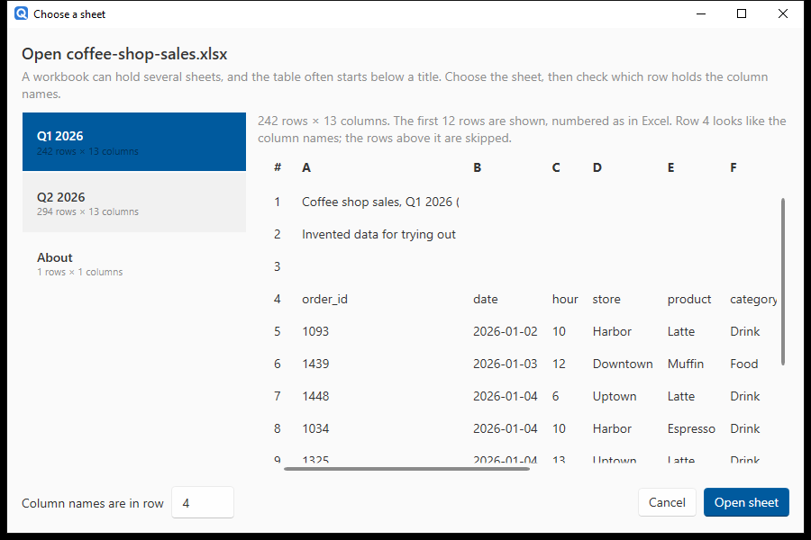
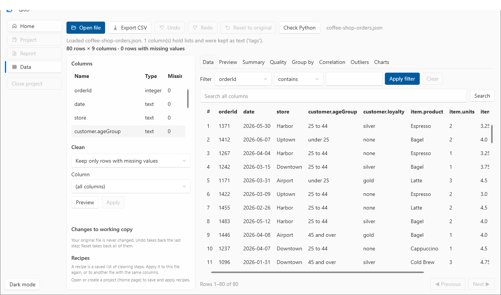

# 7. Excel and JSON files

**You will:** open a workbook whose table starts below a title, and a JSON file with nested fields. About 10 minutes.

**You need:** [`coffee-shop-sales.xlsx`](../../sample-data/coffee-shop-sales.xlsx) and [`coffee-shop-orders.json`](../../sample-data/coffee-shop-orders.json) from the sample data.

## Excel workbooks

**Open file** accepts `.xlsx` and `.xlsm`. Choose the sample workbook, and a **sheet picker** appears:

- **Left:** every sheet in the workbook with its size (hidden sheets are marked). This workbook has `Q1 2026`, `Q2 2026` and an `About` sheet that holds only text.
- **Right:** a preview of the selected sheet, **numbered the way Excel numbers it** (row numbers on the left, column letters across the top), so what you see matches what you see in Excel.
- **Column names are in row:** the sheet starts with a title and a note, so the table's header is on **row 4**. QiUD works that out for you (*"Row 4 looks like the column names; the rows above it are skipped"*) and fills in the number. You can change it.

Choose **Open sheet**. One sheet opens at a time. To work with the other quarter, open the file again and pick the other sheet.

How Excel data arrives:

- Numbers, dates and true/false keep their Excel types. A column that mixes numbers and text opens as text.
- Completely empty rows and unnamed empty columns are skipped, and the status line says how many.
- A project remembers each workbook dataset's **sheet and header row**, so reopening it does not ask again.
- The workbook is only read, never changed.

Limits: formulas are read from the values Excel last saved (a formula Excel never calculated reads as empty); `.xls`, `.xlsb` and `.ods` are not supported (save as `.xlsx` first); password-protected workbooks are refused with an explanation.

> **If you close the picker** without choosing, nothing is opened and you are taken back to the page you were on, instead of being left on an empty screen.

## JSON files

**Open file** also accepts `.json`, `.jsonl` and `.ndjson`. Choose the sample `coffee-shop-orders.json`:

QiUD turns **records** into a table:

- a list of objects, `[{"a": 1}, {"a": 2}]`;
- an object that wraps such a list, `{"status": "ok", "results": [...]}` (the biggest list is used, and the load message names it and any lists that were ignored);
- **JSON Lines**, one object per line.

**Nested objects become columns** named like `customer.ageGroup` and `item.product`, in the order the fields appear in the file.

In the sample, the orders have a `tags` list. The status line says: *"1 column(s) hold lists and were kept as text ('tags')"*. Lists are not exploded into extra rows, and QiUD tells you rather than silently dropping them.

Other things to know:

- JSON `null` and `""` are missing values. Text such as `N/A` stays text, as with a CSV.
- A key that is missing from some records becomes an empty cell.
- A column that mixes kinds (numbers and the word `"Total"`) is kept as text, and the load message names it.
- The file must be UTF-8 and is read whole into memory.

**Cleaned JSON can be saved as JSON again.** Use **Export data…** and choose **JSON** (or **JSON Lines**). The nested fields come out flat: a column called `customer.ageGroup` is written as one key with that name, not rebuilt as an object inside `customer`.

From here everything works as before: [clean it](02-clean-your-data.md), [chart it](04-charts.md), [report on it](06-build-a-report.md).

## CSV details worth knowing

- Delimiters are detected (comma, semicolon, tab, pipe); quoted fields and a UTF-8 byte-order mark are handled; older Windows-1252 files open with a note.
- "Missing" means an **empty cell**. Placeholders such as `N/A` or `-` stay as text; use **Remove rows where…** or **Replace missing values with…** to deal with them.
- Dates are not detected on load. A date column opens as text, and the Quality tab suggests converting it (see [tutorial 2](02-clean-your-data.md)). Text such as `03/04/2026` is read as month/day/year.
